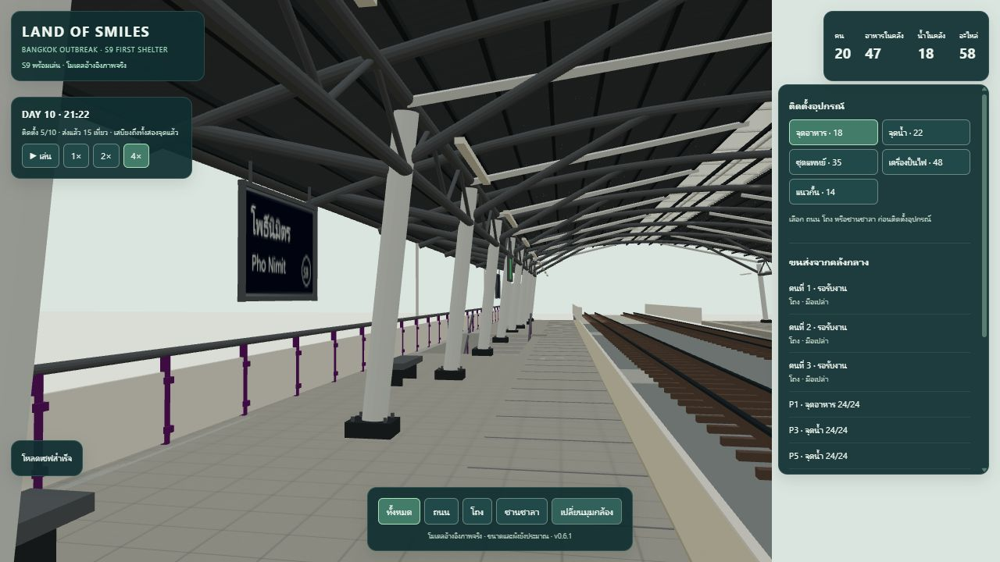

# S9 v0.6.1 — เทียบภาพและทดสอบรายละเอียดในเกม

**วันที่:** 2026-10-14 · **ผล automated:** Pass 18/18 · **Environment:** Windows, Codex In-app Browser desktop 1280×720

[เปิดหน้าภาพเทียบ](../../art/s9-pho-nimit/detail-review.html) · [เกม](../../src/index.html) · [ไฟล์โมเดล](../../src/assets/s9-pho-nimit-gameplay-v061.glb) · [สคริปต์เพิ่มรายละเอียด](../../art/s9-pho-nimit/detail_model.py)

## รายละเอียดที่ปรับตามภาพ

| ส่วน | หลักฐาน | การปรับในเกม |
|---|---|---|
| หลังคา | REF-01, 09, 10 | เปลี่ยนผิวเรียบเป็น geometry ลอนโลหะสองปีกโค้ง กรอบช่องแสงตามยาว ขอบหลังคา รางน้ำครึ่งวงกลม ท่อระบาย และค้ำเฉียง |
| ทางขึ้น | REF-03, 07, 09, 11 | หลังคาโค้งทางเชื่อม คานรูปตัวไอ แผงราวครีม/เสาม่วง และรายละเอียดหลังคาบันได; ตำแหน่ง/จำนวนทางขึ้นยังประมาณ |
| ป้าย | REF-01, 09, 10 | ป้ายชื่อกรมท่าไทย–อังกฤษ/S9 สัดส่วนใหม่ กรอบโลหะและตัวแขวน ป้ายภายนอก และป้ายทางออกเขียว; ไม่คัดลอกภาพถ่ายเป็น texture |
| วัสดุ | REF-01, 03, 07, 10, 11 | คอนกรีตมีคราบ ผนังฟ้ามีรอยสี กระเบื้องแบ่งร่องตามระยะ ลายแผ่นสัมผัส และค่า metallic/roughness แยกเหล็กทาสี สเตนเลส กับพื้นผิวแร่ |

ดู [ภาพและเครดิต](../../art/s9-pho-nimit/references/README.md) ภาพทั้งหมดอยู่ในชุดเดิมปี 2017/2023 ใช้เทียบลักษณะ ไม่ได้ยืนยันสภาพปี 2026 สี/ระยะจริงหรือทุกส่วนที่ภาพไม่ครอบคลุม Texture ทั้งหมดสร้างจากสคริปต์ ไม่มีพิกเซลภาพถ่ายใน GLB โลโก้องค์กรที่ไม่มี artwork ชัดเจนไม่ได้จำลองลงป้ายภายนอก

เพิ่มกล้องภาพรวม ด้านบน ภายนอก ชานชาลาระยะใกล้ และทางขึ้นในมุม **ทั้งหมด**; กด **เปลี่ยนมุมกล้อง** วนดูได้ ปรับแสงสะท้อนใต้หลังคาให้วัสดุอ่านได้ง่ายขึ้น

## การคงเส้นทางและแก้จุดชน

พื้น 24 ส่วน ขั้นบันได/connector 8 ชุด จุดวาง 10 จุด คลัง และ layout ID ตรงกับ v0.6 เซฟเดิมจึงใช้ต่อได้ ปลายราวและคานทางเชื่อมสิ้นสุดก่อนชานพัก 5 เมตร และนำเสาปลายทางเชื่อมที่ขวางศีรษะขณะขึ้นบันไดออก 8 ต้น จำนวน static bounds เปลี่ยนจาก 764 เป็น 756 โดยลดขอบเขตเฉพาะบริเวณทางเชื่อม

การตรวจใหม่ตรวจ bounding boxes ของรายละเอียดและเสา/ราวสะพานกับรัศมีตัวละคร 0.35 เมตร สูง 1.8 เมตรตาม waypoint ถึง P1–P10 และ E1–E4 ทั้งหมด แก้ปัญหาที่การตรวจพื้นราบอย่างเดียวไม่พบ โดยไม่ย้ายจุดวางหรือขั้นบันได

## หลักฐานอัตโนมัติ

- [ผลรวม 18/18](2026-10-14-s9-detail/all-tests.tap): integration เดิม 13 ข้อ และ [detail tests](../../tests/s9-detail.test.mjs) 5 ข้อ ครอบคลุมการผูกวัสดุกับ mesh/UV, embedded textures, ความเข้ากันได้ของ layout, visibility, head clearance และโหลดไฟล์ cargo save จริงจาก v0.6 แล้วส่งต่อจนจบ
- [glTF Validator](2026-10-14-s9-detail/gltf-validation.json): **0 errors / 0 warnings / 0 infos** มี 141 hints เรื่อง bufferView target
- [Model report](../../art/s9-pho-nimit/detail/model-report.json): 2,230,356 bytes; 3,741 nodes; 144 shared meshes; 197,920 triangles รวม instance; SHA-256 `9ee9473e012ee2e17a949f4095a4dbc87a5f10e23ee4ef578e84f8c1fa94df80`
- เก็บ [snapshot v0.6](../archive/runtime-v0.6/README.md) และไฟล์ reference V1 เดิมไว้

## Browser QA

[ข้อมูลที่อ่านจาก UI](2026-10-14-s9-detail/browser-evidence.json) และภาพด้านล่างบันทึกจากเกมจริง ใช้ `?qa=1` แยกช่องเซฟจากผู้เล่น

- โหลดเซฟ v0.6 เดิมที่ 15 เที่ยว อาหารคลัง 47 น้ำ 18 และ parts 58 กับโมเดลใหม่ได้
- ถอน/วางอาหาร P5 น้ำ P6 บนชานชาลาสองฝั่ง และน้ำ P10 บนถนนได้ ส่งจนทั้ง 6 จุดเต็ม เกิดการใช้เสบียงรายวันและเติมกลับ รวม 26 เที่ยว อาหารคลัง 18 น้ำ 12 parts 40
- บันทึก/reload ตอน idle แล้วค่าที่อ่านตรงกัน และทดสอบใหม่ขณะ worker ทั้งสามถือน้ำคนละ 8 หน่วย: เวลา ตำแหน่ง phase และยอดสต็อกตรงกันหลัง reload
- หลังโหลด cargo save เดินต่อจน P10 เต็ม รวม **29 เที่ยว** (เพิ่ม 14 เที่ยวจากเซฟเดิม) พนักงานทั้งสามกลับคลังมือเปล่า อาหารคลัง 18 + จุดแจก 72 + ใช้ 5 = 95; น้ำคลัง 12 + จุดแจก 72 + ใช้ 6 = 90
- โหลด mesh 3,741 ชิ้นผ่าน 165 instanced batches; console ไม่พบ error/warn ในแท็บที่ตรวจรุ่นสุดท้าย ดู [ภาพส่งของครบ](2026-10-14-s9-detail/delivery-complete.jpg)
- ภาพรวม กล้องมุมภายนอก มุมชานชาลา และมุมทางขึ้นแสดงโมเดลใหม่จริง; floor cutaway ซ่อนชิ้นหลังคา/คงจุดวางตามชั้น

[ภาพรวม](2026-10-14-s9-detail/overview.jpg) · [ภายนอก](2026-10-14-s9-detail/exterior.jpg) · [ทางขึ้น](2026-10-14-s9-detail/access-detail.jpg)

## ขอบเขต

เป็นโมเดลอ้างอิงภาพที่ปรับสำหรับเกม ไม่ใช่การสแกนหรือแบบสำรวจ ไม่มีการอ้างคะแนนความเหมือนเป็นเปอร์เซ็นต์ รายละเอียดตำแหน่งทางออก ป้ายบอกทิศที่ครบถ้วน ลิฟต์ งานระบบ โฆษณาและอาคารรอบสถานียังไม่ยืนยัน ไม่ได้วัด performance budget ระยะยาวหรือทดสอบมือถือจริง
