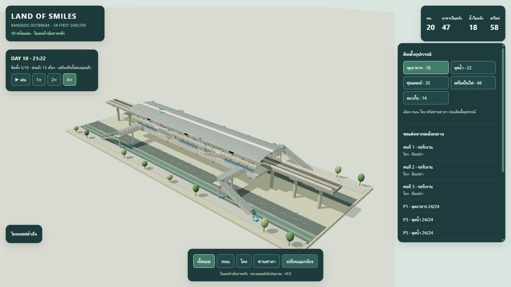

# S9 v0.6 — นำโมเดลเข้าเกมและตรวจการใช้งาน

**วันที่:** 2026-10-14  
**ผล:** Pass ตามขอบเขตด้านล่าง  
**Environment:** Windows; Codex In-app Browser; desktop 1280×720 และ viewport 390×844; ไม่ได้เก็บเลขเวอร์ชัน browser และไม่ได้ทดสอบบนมือถือจริง  
**เกม:** [src/index.html](../../src/index.html) · [วิธีรัน](../../src/README.md) · [บันทึกการเปลี่ยนแปลง](../../src/CHANGELOG.md)

## สิ่งที่เปลี่ยนและตรวจ

Runtime โหลด `s9-pho-nimit-gameplay-v06.glb` ตาม manifest แล้ว ใช้ Y-up ทั้งโมเดล ทางเดิน จุดวางของ และ worker ไม่มีการหมุน -90 องศาแบบ blockout เดิม โมเดล gameplay เพิ่มช่องเปิดราวเข้าสะพาน 4 จุด และพื้นพักบนบันได 4 จุด เพื่อให้พื้นต่อถึงกัน

สคริปต์ [build_s9_runtime.py](../../tools/build_s9_runtime.py) สร้างโมเดลและข้อมูลพื้น 24 ส่วน บันได 8 ชุด collision 764 ขอบเขต และ socket 10 จุดในครั้งเดียว Navigation ใช้กริด 1 เมตรบนพื้นพร้อมลิงก์ตาม tread ของบันได ไม่เปิดพื้นที่ราง ถนน หรือคลองเป็นทางลัด

## Automated checks

**13 tests ผ่านทั้งหมด** ตาม [ผล Node test runner](2026-10-14-s9-integration/unit-tests.tap) และ [ชุดทดสอบ](../../tests/s9-integration.test.mjs)

- GLB hash ตรง manifest/audit; ทุก mesh มี semantic floor tags; พื้นและขั้นบันไดอ้างกลับถึง geometry ได้
- เดินจากคลังถึง P1–P10 และ E1–E4; การข้ามชานชาลาใช้โถง การข้ามฝั่งถนนใช้บันได/สะพาน
- ทุกชนิดอุปกรณ์ที่อนุญาตพอดีกับทุก socket; ปฏิเสธจุดซ้ำ ชั้นผิด อะไหล่ไม่พอ ห้อง ราง ช่องบันไดและคลัง โดยไม่หัก parts ผิด
- คลัง 16 ส่ง 8 เหลือ 8 ปลายทางเพิ่ม 8; คลังหมดไม่สร้างของเพิ่ม; หลาย worker ไม่เติมเกินความจุ
- ไม่มีเส้นทางแล้วไม่รับ/ไม่ส่งของ; worker ที่ถูกตัดเส้นทางเก็บ cargo และเดินต่อได้เมื่อเปิดทาง
- ถอนปลายทางขณะขนส่งแล้วคืนของเข้าคลัง; วางอุปกรณ์ใหม่แล้ว replan โดยไม่ teleport
- Pause หยุด state; 2× และ frame size ต่างกันให้ผลจำลองตรงกัน
- เซฟบนบันไดรักษาตำแหน่ง cargo และบัญชีเสบียง แล้วส่งงานต่อได้; เซฟเสียถูกปฏิเสธโดยไม่แทนที่ state บางส่วน
- นำเข้า v0.5 ตาม ID จุดติดตั้งและยอดเดิม พร้อมเริ่ม ledger ใหม่; การใช้เสบียงรายวันบันทึกยอดใช้

[Khronos glTF Validator 2.0.0-dev.3.10](2026-10-14-s9-integration/gltf-validation.json): **0 errors, 0 warnings** มี 2 infos เรื่อง texture 1024×320 และ 20 hints เรื่อง bufferView target ซึ่งไม่ขัดขวางการโหลด ไฟล์สุดท้าย 934,952 bytes

## Browser checks ที่รันจริง

ใช้ `?qa=1` แยกช่องเซฟทดสอบจากช่องผู้เล่น ดู [ข้อมูลที่อ่านจาก UI](2026-10-14-s9-integration/browser-evidence.json)

| กรณี | ผลที่สังเกต |
|---|---|
| Baseline ก่อนแก้ | v0.5 โหลด blockout และ canvas ได้; เก็บ [ภาพเดิม](2026-10-14-s9-integration/baseline-v05.jpg) |
| โหลดโมเดลใหม่ | GLB แสดงในเกมจริงและขึ้น S9 พร้อมเล่น; dependency โหลดในโปรเจกต์ |
| ชั้นและกล้อง | ดู All / ถนน / โถง / ชานชาลาได้; หมุนและซูมด้วยเมาส์ได้; All ไม่มีปุ่มติดตั้งที่คลิกทะลุชั้น |
| วางครั้งเดียว | อาหาร P1: parts 160 → 142 และปุ่ม P1 ถูกปิด; คลิกบน canvas ที่ P3 ในมุมบนติดตั้งน้ำจริง parts 142 → 120 |
| ส่งข้ามชั้น | P1/P3 ในโถง, P5 บนชานชาลา, P9 บนถนน ได้ 24 หน่วยต่อจุด รวม 12 เที่ยว: คลังอาหาร 47, น้ำ 42 |
| Pause | หยุด 38.147 วินาทีแล้วเวลา parts สต็อก และตำแหน่ง worker ใน UI ไม่เปลี่ยน |
| Save/reload | โหลดกลับแล้ว fields ที่ตรวจตรงกัน รวมตำแหน่งและ phase ของ worker ระหว่างกลับคลัง |
| Cargo ขณะเซฟ | น้ำในคลัง 34 + worker ถือ 8 + จุดน้ำเดิม 48 = 90; หลัง reload ค่าและตำแหน่งตรงเดิม; [เซฟจากปุ่มส่งออก](2026-10-14-s9-integration/cargo-save.json) โหลดด้วย simulation validator ได้ |
| เดินต่อหลัง reload | เติม P10 ถนนครบ 24 หน่วย รวม 15 เที่ยว; อาหารคลัง 47 + จุดแจก 48 = 95; น้ำคลัง 18 + จุดแจก 72 = 90; worker ทั้งสามกลับคลังมือเปล่า |
| Viewport มือถือ | 390×844 เปิดเมนู เลือกชั้น วาง clinic P2 (parts 80 → 45), ถอนคืนเป็น 80 และบันทึกได้; คืน viewport เดิมหลังตรวจ |
| Console หลังแก้ | ไม่มี error/warn ใหม่ในช่วงตรวจสุดท้าย |
| หน้าสำหรับเล่นจริง | เปิด `/src/` โดยไม่มี `?qa=1`; ครั้งแรกแสดงหน้า v0.5 ที่เบราว์เซอร์เก็บไว้ รีโหลดแล้วเป็น v0.6 และขึ้น S9 พร้อมเล่น ไม่มี error/warn; เริ่ม 0 จุด/0 เที่ยว อาหาร 95 น้ำ 90 parts 160 ไม่ปนเซฟ QA |

## ภาพผลลัพธ์

- [ชานชาลาและสต็อกที่ส่งถึงแล้ว](2026-10-14-s9-integration/desktop-platform.jpg)
- [หน้าจอมือถือ](2026-10-14-s9-integration/mobile-game.jpg)
- [ติดตั้งอุปกรณ์ใน viewport มือถือ](2026-10-14-s9-integration/mobile-placement.jpg)
- [หน้าพร้อมเล่นสำหรับผู้ใช้](2026-10-14-s9-integration/player-ready.jpg)

## ปัญหาที่พบและแก้ระหว่างงาน

- Metadata-only update ของ trimesh ไม่เปลี่ยน GLB extras เมื่อ transform เดิมเหมือนกัน ทำให้ loader ปฏิเสธไฟล์รอบแรก แก้ exporter และเพิ่มการตรวจ tag ทุก mesh
- ผิวโถงเดิมไม่รวมขอบ slab ทำให้พื้นก่อนสะพานมีช่องว่าง 0.25 เมตรใน navigation เพิ่มผิว slab ที่มีจริงให้ graph ต่อถึงสะพาน
- ปรับช่องราวและพื้นพักให้ร่างกายเดินผ่านรอยต่อได้ แทนลิงก์ข้ามชั้นแนวตั้งเดิม
- แยกพื้นที่ canvas บน desktop เพื่อไม่ให้แผงควบคุมบังสถานี และทำเมนูยุบได้บนหน้าจอแคบ

## ขอบเขตที่ยังไม่ยืนยัน

ความคลาดเคลื่อนเทียบสถานีจริง ขนาด/หมายเลขทางเข้า สภาพปัจจุบัน และผังที่ไม่มีภาพยังไม่ยืนยัน ภาพต้นทางปี 2017/2023 ไม่ใช่การสำรวจ

ยังไม่ตรวจ real-device Mobile Safari/Android, เบราว์เซอร์อื่น, performance budget ระยะยาว, crowd avoidance ระหว่าง worker, elevator/accessibility routing, free placement หรือ gameplay/balance ทั้ง campaign การย้ายเซฟ v0.5 ผ่าน automated tests แต่ไม่ได้เปลี่ยนเซฟ v0.5 จริงของผู้ใช้ระหว่าง browser QA

ไม่มี Git repository ใน workspace จึงใช้ [snapshot v0.5](../archive/runtime-v0.5/README.md) เป็นประวัติก่อนแก้ ไม่ได้สร้าง PR หรือ commit
