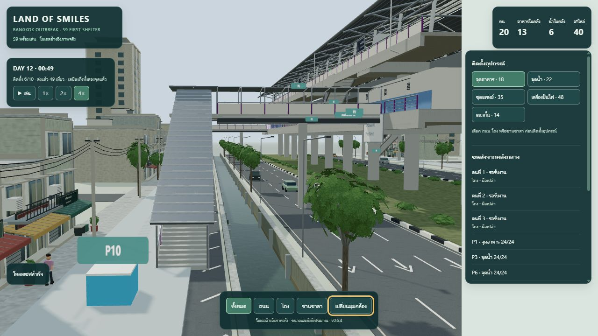
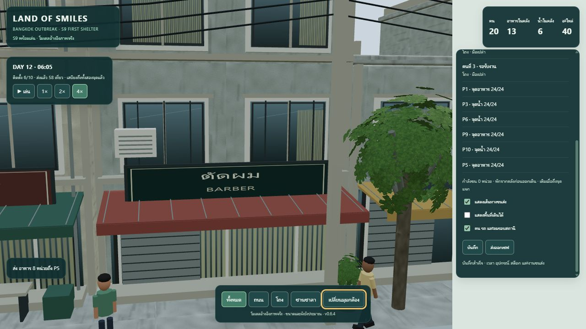
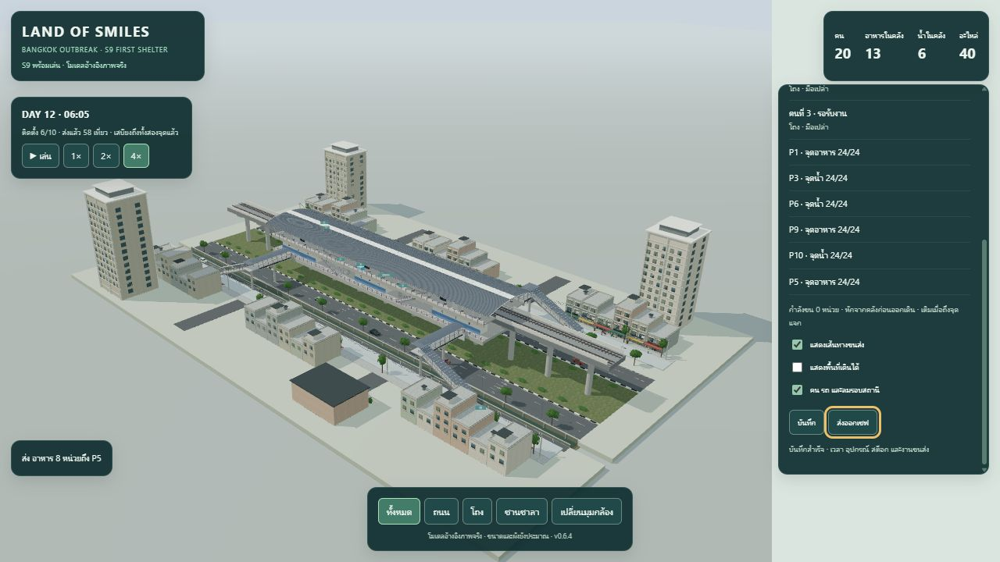

# S9 v0.6.4 — คนเดิน รถวิ่ง และใบไม้ไหว

วันที่ 2026-10-14 · [เปิดเกม](http://127.0.0.1:8765/src/)

เพิ่มชีวิตรอบสถานีบนโมเดล v0.6.3 เดิม เป็น animation ของตัวประกอบ ไม่เปลี่ยนประชากร สต็อก กฎวางของหรือเส้นทางขนส่ง

## สิ่งที่เพิ่ม

- คนเดิน 12 คนบนแนวพื้นหน้าร้านสองฝั่ง พร้อมแขนขาสลับจังหวะ หยุดและกลับตัวที่ปลายทาง แต่ละคนมีช่วงเดินของตัวเอง จึงไม่เดินสวนทะลุกัน
- รถ 6 คันในเลนกลางสองทิศทาง ความเร็ว 6.5 เมตร/วินาทีในสเกลฉาก เว้นระยะต่อคันประมาณ 69 เมตร มีล้อหมุนและค่อย ๆ จางที่ขอบฉากก่อนวนกลับ รถจอดเดิมยังอยู่ในเลนอื่น
- ใบไม้ 156 กลุ่มไหวต่างจังหวะตามตำแหน่ง ด้วย vertex shader ระยะไหวจำกัดและใช้ deformation เดียวกันใน shadow depth pass
- ปุ่ม **คน รถ และลมรอบสถานี** หยุด/เล่นตัวประกอบได้โดยไม่เปลี่ยน pause/speed ของเกม มุมตัดโถง/ชานชาลาซ่อนคนและรถพร้อมพักลม; แท็บซ่อนพักนาฬิกาฉากโดยไม่เร่งชดเชยเมื่อกลับมา เปิดหน้าด้วย reduced motion จะเริ่มปิด animation

เวลา animation แยกจากเวลา simulation จึงยังเห็นคน รถและลมขณะหยุดเกมเพื่อวางของ ตำแหน่งตัวประกอบเริ่มวงรอบใหม่เมื่อรีโหลด ไม่ถูกบันทึกลงเซฟ ความเร็วเกม 1×–4× ไม่มีผลต่อความเร็วฉากรอบนอก

## พื้นที่เล่น

ทดสอบกรอบที่ตัวละครและรถกวาดผ่านตลอดเส้นทาง ไม่ใช้เพียงตัวอย่างตำแหน่งไม่กี่เฟรม: ไม่ทับพื้นเดินทั้ง 24 ส่วน จุดวางทั้ง 10 จุด บันได 8 ชุด หรือ geometry ของของตกแต่งริมถนน กรอบคนอยู่บนพื้นหน้าร้าน กรอบรถอยู่ในถนนเดิมทั้งช่วง ใบไม้รวมระยะไหวสูงสุดยังพ้นพื้นเดินและ headroom ของบันได

GLB, geometry audit, manifest และ schema เซฟ 2 คงเดิม โดย GLB SHA-256 ยังเป็น `d0bad3fc9a33cd3d0830511c337bebf6a3c25904a67c12dddbe9dca5934c2a3a` ไม่ต้อง export โมเดลซ้ำ [สำรองไฟล์ก่อนแก้](../archive/runtime-v0.6.3/README.md)

## ผลตรวจ

**Automated 33/33 ผ่าน** ใน [all-tests.tap](2026-10-14-s9-life/all-tests.tap): 28 checks เดิมและ 5 checks ใหม่ ตรวจ swept bounds, ระยะห่างรถหลายวงรอบ, ความต่อเนื่องคนเดิน, การหยุดเวลา animation, กรอบ shader และการส่งของข้ามชั้น/restore ขณะอยู่บนบันไดพร้อมเสบียง

**Browser QA ผ่าน** บน Codex In-app Browser / Three.js r170:

- โหลดคน 12 คน รถ 6 คัน ใบไม้ 156 กลุ่ม ดูภาพจริงมุมถนนและหน้าร้าน ตำแหน่งคน/รถและ wind time เปลี่ยนขณะที่เวลาเกมหยุด
- ปิด animation แล้ว ambient time ไม่เปลี่ยน; มุมตัดโถงพัก animation และซ่อนตัวประกอบ ไม่มี console error/warning หรือ shader compile error
- ถอนและติดตั้ง P9 อาหาร, P10 น้ำ และ P5 อาหารใหม่ แล้วขนส่งเพิ่ม **9 เที่ยว จาก 49 เป็น 58** ระหว่างฉากเคลื่อนไหว
- บันทึกและรีโหลดระหว่างพนักงานกลับคลัง: เวลา ตำแหน่ง งาน สต็อกและคลังตรงกัน ก่อนให้ส่งต่อจนเสร็จ
- จบที่ 6 จุดเต็ม 24/24 พนักงาน 3 คนกลับคลังและมือเปล่า คลังอาหาร 13 น้ำ 6 อะไหล่ 40 ยอดใช้สะสมอาหาร 10 น้ำ 12; รวมยอด `13+72+10=95`, `6+72+12=90` ตรงตั้งต้น

[Browser evidence](2026-10-14-s9-life/browser-evidence.json) · [เซฟที่ส่งออก](2026-10-14-s9-life/completed-save.json) · [ตรวจเซฟ/ยอด/asset hash](2026-10-14-s9-life/save-validation.json)





## ไฟล์และตรวจซ้ำ

- [เส้นทางและนาฬิกา animation](../../src/game/ambient-motion.mjs)
- [โมเดลตัวประกอบและ shader ลม](../../src/game/ambient.mjs)
- [ผูก renderer](../../src/game/render.mjs), [UI](../../src/game/app.mjs), [tests](../../tests/s9-life.test.mjs)

```powershell
node --test tests/s9-integration.test.mjs tests/s9-detail.test.mjs tests/s9-environment.test.mjs tests/s9-realism.test.mjs tests/s9-life.test.mjs
```

ข้อจำกัด: ตัวประกอบเดินและขับตามเส้นทางที่กำหนด ไม่มี traffic AI, การข้ามถนนหรือการปะทะกับเกมเพลย์; ไม่ใช่การจำลองปริมาณจราจรจริง ทดสอบ hidden/reduced-time guard เชิงระบบ แต่ไม่ได้วัด FPS หรือทดสอบอุปกรณ์มือถือจริง
