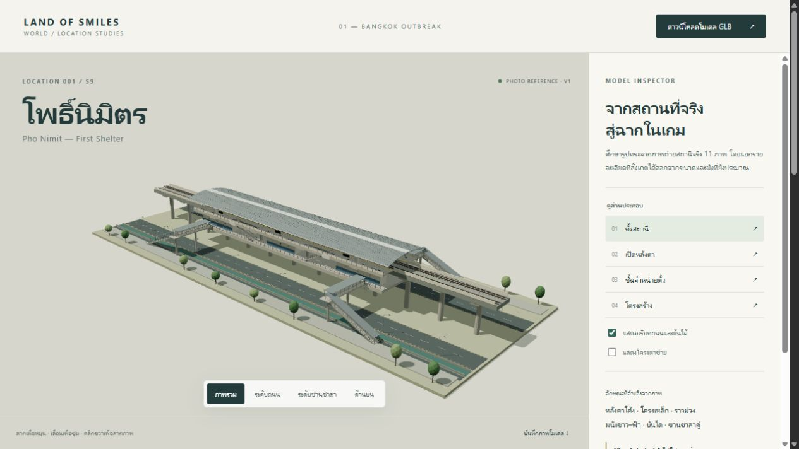

# ตรวจโมเดล S9 และตัวดู 3D

**วันที่:** 2026-10-14  
**ขอบเขต:** asset review และ browser smoke test ของ [S9 Model study V1](../../art/s9-pho-nimit/README.md)  
**สภาพแวดล้อม:** Windows, Codex In-app Browser, HTTP บน `127.0.0.1:8765`, Three.js 0.170.0 ที่เก็บในโปรเจกต์

## ผลตรวจ

| การตรวจ | ผล | หลักฐาน / ขอบเขต |
|---|---|---|
| ส่งออก GLB | Pass | 837,084 bytes; 2,817 mesh nodes; 30 shared meshes; 81,768 triangles เมื่อรวม instances; Y-up, เมตร |
| Khronos glTF Validator 2.0.0-dev.3.10 | Pass | 0 errors, 0 warnings; มี 2 infos เรื่อง texture ขนาด 1024×320 และ 20 hints เรื่อง bufferView target ดู [รายงานเต็ม](../../art/s9-pho-nimit/export/gltf-validation.json) |
| โหลด GLB ในตัวดู | Pass | แสดงโมเดลจริงและสถานะโหลดสำเร็จ; viewer ใช้ 56 instanced batches; console error/warn ที่ตรวจหลังใช้งานเป็น `[]` |
| มุมภาพรวม ถนน ชานชาลา และด้านบน | Pass | เปลี่ยนกล้องผ่านปุ่มและตรวจภาพจริง; ปรับกล้องด้านบนให้เห็นขอบบริบทครบ |
| เปิดหลังคาและเลือกชั้นโถง | Pass | หลังคาหายจากภาพเมื่อเลือกเปิดหลังคา; มุมโถงซ่อนชานชาลาและโครงรองรับชั้นบน |
| โครงสร้าง / ซ่อนบริบท / wireframe | Pass | ซ่อนถนน ต้นไม้ และเสาไฟได้; เห็นโครงตาข่ายเมื่อเปิดสวิตช์; คืนโหมดวัสดุและบริบทได้ |
| ป้ายสถานี | Pass ในขอบเขตภาพที่ตรวจ | แก้ UV กลับหัวและหันป้ายชานชาลาเข้าในสถานี; ป้ายภายนอกแสดงทิศทางตัวอักษรถูกต้อง; ความชัดเมื่อซูม/อุปกรณ์อื่นยังไม่ได้ตรวจทุกกรณี |
| Gallery | Pass | มี 11 cards; เปิด REF-01 ใน dialog พบชื่อผู้ถ่าย วันที่ CC BY-SA 4.0 และปิดกลับได้ |
| ดาวน์โหลด GLB | Pass | ดาวน์โหลดจากปุ่มใน viewer; SHA-256 ของไฟล์ดาวน์โหลดตรงกับไฟล์ export |
| บันทึกภาพจาก canvas | Pass | ดาวน์โหลด PNG สำเร็จ เก็บสำเนาไว้ที่ [ภาพโมเดล](../../art/s9-pho-nimit/export/s9-pho-nimit-model-study.png) |
| ภาพจริงและเครดิต | Pass | ไฟล์ภาพ 11 ภาพตรง SHA-256 ใน sources.json; มีผู้ถ่าย วันถ่าย ต้นฉบับ และสัญญาอนุญาตแยกทุกไฟล์ |

GLB SHA-256 ที่ตรวจ: `fa1ec3c2736e530d3e7c31f291a083cb9b76e3d200d6fa7ee86ee441ac3a9e6b`

## ภาพหลักฐาน

- [เปิดหลังคา](2026-10-14-s9-model-review/roof-off.jpg)
- [ชั้นโถงจากด้านบน](2026-10-14-s9-model-review/concourse-top.jpg)
- [โครงสร้างแบบ wireframe และซ่อนบริบท](2026-10-14-s9-model-review/structure-wireframe.jpg)

## สิ่งที่ผลตรวจนี้ยังไม่ยืนยัน

รูปทรงหลักอ้างอิงจากภาพ 2017/2023 แต่ไม่ได้วัดค่าความคลาดเคลื่อนเทียบสถานีจริง ขนาด ผังทางเข้า หมายเลขทางออก ห้องที่มองไม่เห็น ตำแหน่งเสาและสภาพปัจจุบันยังไม่ยืนยัน จึงใช้สถานะ `photo_referenced_visual_study_not_surveyed`

ยังไม่ทดสอบบนมือถือ เบราว์เซอร์อื่น hardware ระดับต่ำ หรือเกมเต็ม และยังไม่มี performance budget, collision, authored navmesh, placement, save/load QA ของโมเดลใหม่นี้ ตัวดูที่เปิดได้ไม่ใช่หลักฐานว่าเชื่อม simulation แล้ว โมเดลและ manifest ใน `src/` ยังใช้ชุด v0.5 เดิม

ไฟล์ต้นแบบเดิมและ snapshot GDD ตรวจ hash เทียบข้อมูลก่อนงานนี้แล้ว ดู [ผลตรวจไฟล์และลิงก์](2026-10-14-s9-model-review/file-verification.json)
