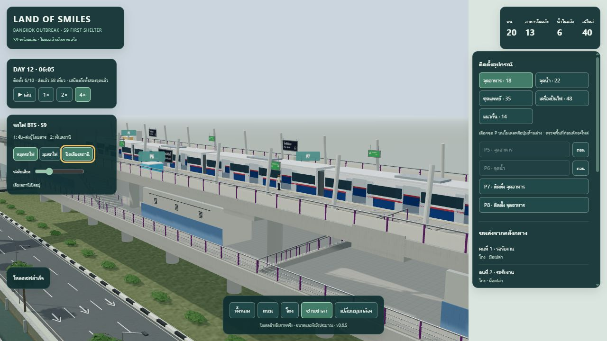
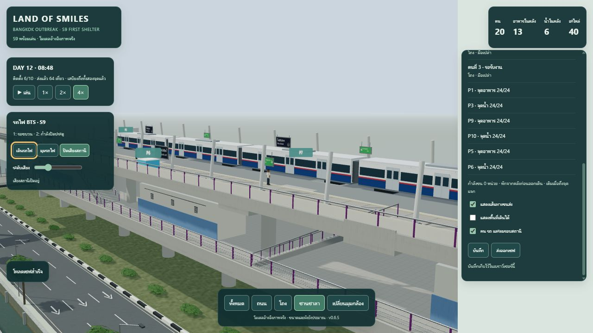

# S9 v0.6.5 — รถไฟ ประตู ผู้โดยสาร และเสียงสถานี

วันที่ 2026-10-14 · [เปิดเกม](http://127.0.0.1:8765/src/)

เพิ่มรถไฟสีขาว–น้ำเงิน–แดงพร้อมป้าย BTS / S9 สองขบวน ขบวนละ 4 ตู้ วิ่งสวนกันและหยุดเทียบสถานี รอบขบวนละ 80 วินาที ห่างกัน 40 วินาที เป็นต้นแบบภาพและจังหวะบริการ ไม่ใช่ตารางเดินรถหรือโมเดลรถรุ่นจริงที่วัดขนาดแล้ว

## พฤติกรรม

1. เข้าสถานีและลดความเร็วจนหยุดสนิท
2. จอดนิ่ง 2 วินาที แล้วเลื่อนประตูเปิด 2 วินาที เฉพาะด้านชานชาลา
3. จอดรับส่ง 12 วินาที ผู้โดยสารลงก่อน 4 วินาทีแรก ผู้โดยสารขึ้นในช่วงวินาที 6–10
4. เตือนก่อนปิด 3 วินาที เลื่อนปิด 2 วินาที และรอประตูปิดครบอีก 2 วินาทีก่อนออก
5. เร่งออกบนแนวรางที่ต่อออกไปนอกสถานี แล้ววนรอบ

รถไฟและผู้โดยสารเป็นตัวประกอบ ไม่มีผลต่อประชากรหรือบัญชีเสบียง มีปุ่ม **หยุดรถไฟ / เดินรถไฟ** แยกจากเวลาเกม และปุ่ม **มุมรถไฟ** สำหรับดูชานชาลา รอบรถไฟพักในมุมตัดถนน/โถงและแท็บที่ซ่อน เริ่มหยุดหากระบบเลือก reduced motion; รีโหลดแล้วเริ่มรอบใหม่ ไม่เขียนสถานะรถไฟลงเซฟ

## เสียง

เสียงสังเคราะห์ใหม่ด้วย Web Audio: เสียงพื้นหลังลม/ระบบอาคาร เสียงล้อและมอเตอร์ที่เปลี่ยนตามความเร็วและระยะทาง เสียงเลื่อนประตู และเสียงสัญญาณเปิด/เตือนปิด ไม่มีเสียงประกาศหรือไฟล์บันทึกเสียง BTS จริง

กด **เปิดเสียงสถานี** เพื่อเริ่มเสียงและเลื่อนระดับ 0–100 ได้ ค่าเริ่มต้น 25 เสียงเริ่มปิดทุกครั้งที่โหลดหน้า ปิดเสียงแล้ว suspend AudioContext; มุมตัดภายในและแท็บซ่อนลด output เป็นศูนย์ ข้อผิดพลาดเปิดเสียงแสดงในแผง โดยไม่ทำให้เกมหยุด

## รางและความปลอดโปร่งของพื้นที่เล่น

ผังต้นแบบเดิมมีรางที่ไม่ตรงระดับ/แนวประตูรถไฟ ปรับเฉพาะการแสดง trackbed, sleeper และ rail: Y ลด 0.5 เมตร และ Z ขยับออกฝั่งละ 0.8 เมตร ให้ศูนย์รางอยู่ ±3.5 เมตร ประตูอยู่ชิดขอบชานชาลาเดิม ขยับ parapet ก่อนเข้าสถานีออกฝั่งละ 0.4 เมตรพร้อมเพิ่มขอบรองรับ และต่อทางยกระดับ/รางถึง X ±260 เมตรเพื่อไม่ให้รถไฟลอยขณะเข้า–ออก

GLB v063, manifest, พื้นเดิน จุดวางของ บันไดและ schema เซฟ 2 คงเดิม การปรับรางเป็น runtime transform ใน [railAdjustment](../../src/game/train-motion.mjs) และ [renderer](../../src/game/render.mjs) ไม่ได้อ้างว่า asset geometry audit เดิมรวมตำแหน่งแสดงใหม่แล้ว

ตรวจกรอบรถไฟตลอดการเคลื่อนที่กับพื้นชานชาลา โครงหลังคาและ parapet ที่ปรับใหม่ ผู้โดยสารใช้จุดรับส่งสองตำแหน่งต่อฝั่ง X ±14.5 บนแถบริมชานชาลา ทดสอบว่าไม่ทับจุดวางของ บันได หรือเส้นทางขนส่งจากคลังไปทุกจุด ตัวประกอบไม่เพิ่ม collision obstacle ให้เกม

## ผลทดสอบ

**Automated 41/41 ผ่าน**: [all-tests.tap](2026-10-14-s9-trains/all-tests.tap)

- 33 checks เดิม ครอบคลุมทางเดิน วางของ เวลา การขนส่งและ save/load
- 6 checks รถไฟ: วงรอบหลายเที่ยว ความเร็วศูนย์ก่อนเปิด ประตูปิดครบก่อนวิ่ง ลำดับผู้โดยสาร กรอบ clearance กับผังจริงในโปรเจกต์ การพักเวลา/เสียง และเซฟไม่เปลี่ยนจาก animation
- 2 checks เสียง: ไม่สร้าง AudioContext ก่อนกดเปิด ใช้ context เดิมเมื่อเปิดซ้ำ ส่งสัญญาณแต่ละ transition ครั้งเดียว mute/suspend และแสดงข้อผิดพลาดเมื่อไม่มี Web Audio

**Browser QA** บน Codex In-app Browser / Three.js r170:

- ตรวจภาพเข้าสถานี ประตูเปิดรับส่ง กำลังปิด และออกจากสถานี: ตอนประตูเปิด x=0 / speed=0 / door=1 ตอนวิ่ง door=0; จับตอนกำลังปิดได้ door=0.98 และ speed=0
- ปุ่มหยุดรถไฟรักษาเวลารถไฟ มุมตัดโถงพักรถไฟและลดเสียงเป็นศูนย์ กลับมาดูแล้วเดินต่อ
- AudioContext running มี RMS มากกว่าศูนย์และจำนวนเสียงเตือนเพิ่ม ลดระดับเป็นศูนย์ได้ RMS=0 และปิดเสียงเป็น suspended
- ถอน/ติดตั้ง P5 อาหารและ P6 น้ำแล้วส่งต่อขณะเดินรถ ได้เพิ่ม **6 เที่ยว จาก 58 เป็น 64** จุดทั้ง 6 เต็ม 24/24 พนักงาน 3 คนกลับคลัง มือเปล่า
- บันทึกและรีโหลดผลขนส่งเสร็จแล้ว เวลา ตำแหน่ง งานและยอดตรงกัน คลังอาหาร 13 น้ำ 6 อะไหล่ 40 ยอดรวมอาหาร 95 น้ำ 90 ตรงตั้งต้น

[Browser evidence](2026-10-14-s9-trains/browser-evidence.json) · [เซฟส่งออก](2026-10-14-s9-trains/completed-save.json) · [ตรวจบัญชีเซฟ](2026-10-14-s9-trains/save-validation.json)




## ตรวจซ้ำ

```powershell
node --test tests/s9-integration.test.mjs tests/s9-detail.test.mjs tests/s9-environment.test.mjs tests/s9-realism.test.mjs tests/s9-life.test.mjs tests/s9-trains.test.mjs tests/s9-station-audio.test.mjs
```

[โมเดลและ animation](../../src/game/trains.mjs) · [เสียง](../../src/game/station-audio.mjs) · [snapshot ไฟล์ก่อนแก้](../archive/runtime-v0.6.4/README.md)

ข้อจำกัด: ผู้โดยสารเป็น animation รับส่งในจุดที่กำหนด ไม่ใช่ระบบเลือกเส้นทาง/จำนวนผู้โดยสารจริง ระยะรางและสัดส่วนรถยังเป็นการปรับเพื่อฉากต้นแบบ การตรวจเสียงยืนยันสัญญาณจาก browser audio graph ไม่ได้ยืนยันเสียงออกลำโพงหรือระดับเสียงบนอุปกรณ์ผู้ใช้ ไม่มีผล FPS benchmark หรือทดสอบมือถือจริง
